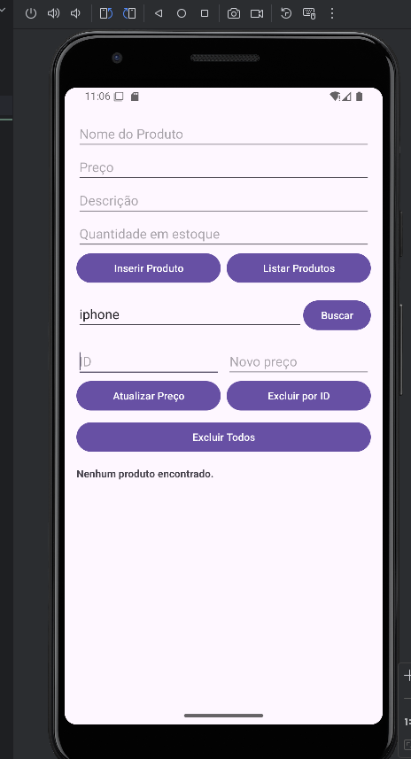
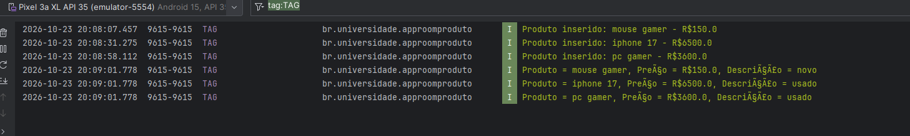
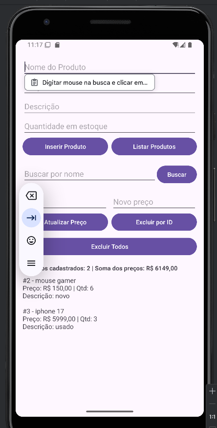
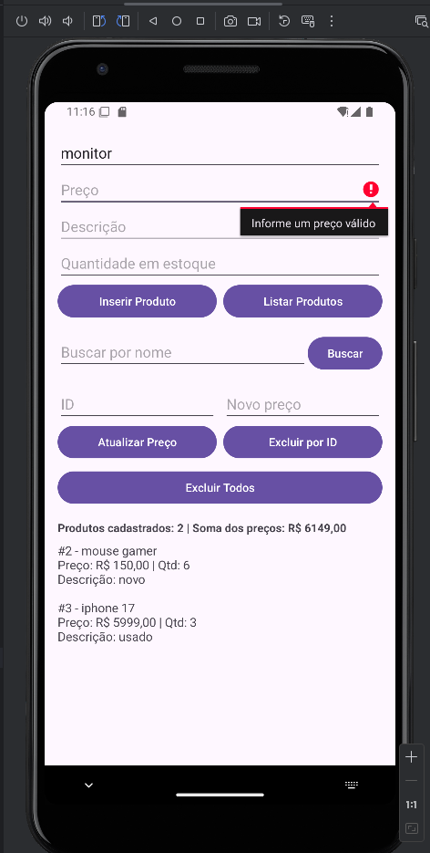
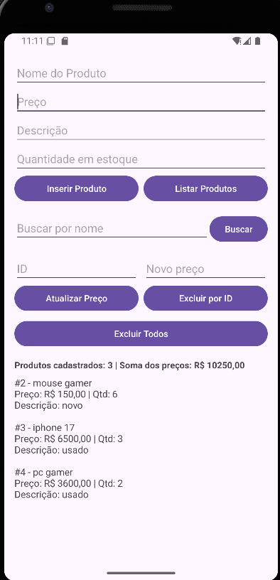
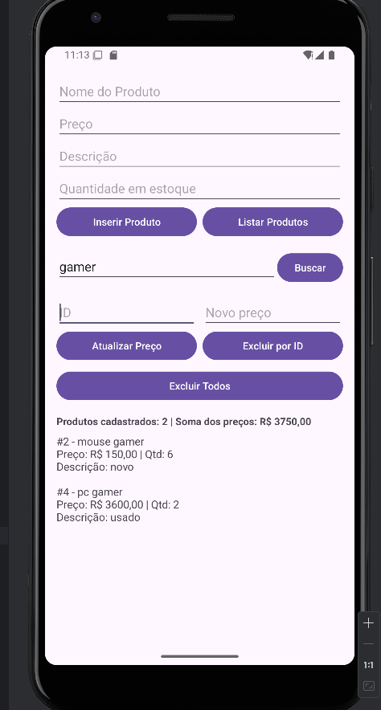
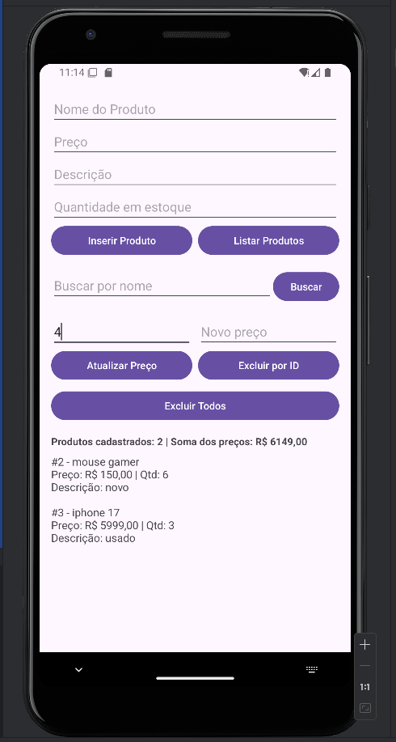
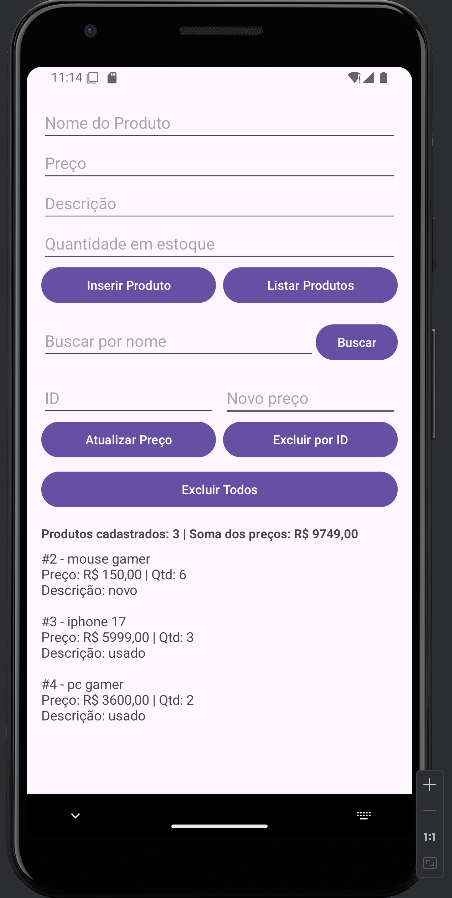
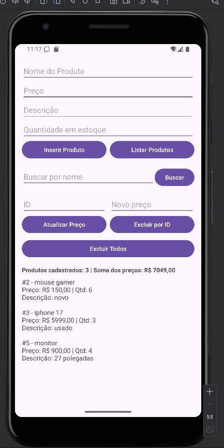

# AppRoomProduto: Cadastro de Produtos com Room SQLite

**Aluno:** Osi Paes Junior **RA:** 237112
**Aluno:** Guilherme Lins dos Santos **RA:** 236161
**Disciplina:** Programação para Dispositivos Móveis  
**Professor(a):** ALESSANDRO FERREIRA PAZ LIMA

## Sobre o projeto

O projeto consiste em um aplicativo Android desenvolvido em Kotlin para cadastrar e gerenciar produtos. Com ele, é possível cadastrar, listar, buscar, atualizar e excluir produtos.

Para salvar os dados, utilizei o Room, que trabalha com o banco de dados SQLite. Dessa forma, os produtos continuam salvos mesmo depois que o aplicativo é fechado.

## Tecnologias utilizadas

- Kotlin
- Room 2.6.1 (SQLite)
- ViewBinding
- Corrotinas com lifecycleScope

Os textos da tela e das mensagens ficam em `res/values/strings.xml`, e o pacote do app é
`br.universidade.approomproduto`, como no tutorial.

## Estrutura do projeto

```text
app/src/main/
├── java/br/universidade/approomproduto/
│   ├── model/Product.kt      ← Entidade dos produtos
│   ├── dao/ProductDao.kt     ← Operações do banco de dados
│   ├── db/AppDatabase.kt     ← Configuração do banco
│   └── view/MainActivity.kt  ← Tela principal do aplicativo
└── res/
    ├── layout/activity_main.xml  ← Layout da tela
    └── values/strings.xml        ← Textos do app
```

## Prints do aplicativo





---

# Parte A: Complemento prático

## A1. Limpar campos após inserir

**O que foi feito:**

Fiz uma função chamada `limparCampos()` para limpar todos os campos depois que um produto é cadastrado com sucesso. Também coloquei o cursor de volta no campo Nome para facilitar o cadastro de outro produto.

Chamei essa função depois de salvar o produto no banco, assim os campos só são limpos quando a operação termina.

```kotlin
private fun limparCampos() {
    binding.editProductName.text.clear()
    binding.editProductPrice.text.clear()
    binding.editProductDescription.text.clear()
    binding.editProductQuantity.text.clear()
    binding.editProductName.requestFocus()
}
```

**Print:**



## A2. Validação de preço

**O que foi feito:**

Adicionei uma validação para impedir que o usuário cadastre produtos com preços inválidos. Utilizei `toDoubleOrNull()` para converter o valor digitado em número.

Se o campo estiver vazio, tiver um valor inválido ou o preço for menor ou igual a zero, o aplicativo mostra uma mensagem de erro e não salva o produto.

```kotlin
val price = binding.editProductPrice.text.toString().toDoubleOrNull()

if (price == null || price <= 0.0) {
    binding.editProductPrice.error = getString(R.string.erro_preco_invalido) // "Informe um preço válido"
    binding.editProductPrice.requestFocus()
    return
}
```

**Print:**



## A3. Lista na tela

**O que foi feito:**

Antes, os produtos eram exibidos apenas no Logcat. Para melhorar isso, adicionei um `TextView` chamado `txtListaProdutos` abaixo dos botões.

Agora, quando clico em **Listar Produtos**, os dados continuam aparecendo no Logcat, mas também são exibidos na própria tela. A lista mostra o ID, o nome, o preço, a quantidade e a descrição de cada produto.

```kotlin
binding.txtListaProdutos.text = products.joinToString("\n\n") {
    getString(
        R.string.item_produto, // "#%1$d - %2$s\nPreço: %3$s  |  Qtd: %4$d\nDescrição: %5$s"
        it.id,
        it.name,
        formatarReais(it.price),
        it.quantity,
        it.description.orEmpty().ifEmpty { "-" }
    )
}
```

**Print:**



## A4. Total do estoque

**O que foi feito:**

Adicionei um resumo acima da lista de produtos. Ele mostra quantos produtos estão cadastrados e a soma dos preços registrados.

Para calcular essas informações, utilizei `products.size` para contar os produtos e `sumOf` para somar os preços. O resultado é formatado em reais.

```kotlin
val total = products.sumOf { it.price }

binding.txtResumo.text =
    getString(R.string.resumo_produtos, products.size, formatarReais(total))
```

**Print:**


## A5. Buscar por nome

**O que foi feito:**

Adicionei um campo de busca e um botão chamado **Buscar**, além de uma função no DAO para pesquisar os produtos pelo nome.

A busca funciona mesmo quando o usuário digita apenas uma parte do nome. Por exemplo, ao pesquisar por "tec", o aplicativo consegue encontrar um produto chamado "Teclado".

Para isso, utilizei o comando SQL `LIKE` com o caractere `%`, que permite encontrar nomes que contenham o texto pesquisado.

```kotlin
// DAO
@Query("SELECT * FROM product WHERE name LIKE :nome")
suspend fun buscarPorNome(nome: String): List<Product>

// MainActivity
val resultado = productDao.buscarPorNome("%$texto%")
mostrarNaTela(resultado)
```

**Print:**



## A6. Excluir produtos

**O que foi feito:**

Implementei a opção de excluir todos os produtos cadastrados por meio do botão **Excluir Todos**.

Também fiz a exclusão de um produto específico como desafio extra. Nesse caso, o aplicativo procura o produto pelo ID e, se ele existir, realiza a exclusão.

```kotlin
// DAO
@Query("DELETE FROM product")
suspend fun deleteAll()

@Delete
suspend fun delete(product: Product)

@Query("SELECT * FROM product WHERE id = :id")
suspend fun getById(id: Int): Product?

// MainActivity (excluir por ID)
val product = productDao.getById(id)

if (product != null) {
    productDao.delete(product)
}
```

**Print:**



## A7. Atualizar produto

**O que foi feito:**

Adicionei a opção de atualizar o preço de um produto. Para isso, o usuário informa o ID do produto e o novo preço e clica em **Atualizar Preço**.

O aplicativo procura o produto pelo ID e, caso ele exista, cria uma cópia com o novo preço usando `copy()`. Depois, utiliza o `@Update` do Room para salvar a alteração no banco de dados.

```kotlin
// DAO
@Update
suspend fun update(product: Product)

// MainActivity
val product = productDao.getById(id)

if (product != null) {
    productDao.update(product.copy(price = novoPreco))
}
```

**Print:**



## A8. Novo campo na tabela (quantity)

**O que foi feito:**

Adicionei o campo `quantity` à classe `Product` para armazenar a quantidade de cada produto em estoque. Também incluí o campo correspondente na tela e alterei a versão do banco de dados de 1 para 2.

```kotlin
@Entity
data class Product(
    @PrimaryKey(autoGenerate = true) val id: Int = 0,
    @ColumnInfo(name = "name") val name: String,
    @ColumnInfo(name = "price") val price: Double,
    @ColumnInfo(name = "description") val description: String?,
    @ColumnInfo(name = "quantity") val quantity: Int = 0
)

@Database(entities = [Product::class], version = 2)
abstract class AppDatabase : RoomDatabase() { ... }
```

**O que aconteceu com os produtos que já estavam cadastrados?**

Os produtos cadastrados anteriormente foram apagados. Isso aconteceu porque o banco antigo estava na versão 1 e não tinha a coluna `quantity`.

Como não configurei uma migração para passar da versão 1 para a 2, o `fallbackToDestructiveMigration()` apagou o banco antigo e criou outro com a nova estrutura.

Durante o desenvolvimento, isso facilita as alterações, mas não seria uma boa solução para um aplicativo já publicado, pois os usuários poderiam perder seus dados ao atualizar o app.

Para evitar isso, poderia criar uma `Migration` para adicionar a nova coluna sem apagar os produtos existentes. O comando SQL seria:

```sql
ALTER TABLE product
ADD COLUMN quantity INTEGER NOT NULL DEFAULT 0;
```

**Print:**



---

# Parte B: Questões dissertativas

## B1. O que é persistência de dados? O que aconteceria se os produtos fossem guardados apenas em uma MutableList dentro da MainActivity?

Pra mim, persistência de dados é fazer a informação "sobreviver" ao programa: o dado é gravado em
um lugar permanente, como um arquivo ou um banco, e não fica só na memória enquanto o app está aberto.
No AppRoomProduto isso acontece quando eu clico em **Inserir Produto**: o `productDao.insertAll()` grava
o produto no arquivo SQLite `database-name`, que fica guardado no próprio celular. Testei fechando o app
pelo emulador e abrindo de novo, e ao clicar em **Listar Produtos** os itens continuavam lá.
Se eu tivesse usado uma `MutableList<Product>` dentro da `MainActivity`, a lista existiria só na RAM,
presa àquele objeto da Activity. Qualquer coisa que destruísse a Activity, como fechar o app, o sistema
matar o processo para liberar memória ou até girar a tela, faria a lista voltar vazia.
Ou seja, funcionaria só enquanto a tela estivesse aberta, o que não serve para um cadastro de verdade.

## B2. Qual é a diferença entre usar o SQLite diretamente e usar o Room? Cite pelo menos duas vantagens do Room.

O SQLite é o banco em si, e o Room é uma biblioteca do Jetpack que fica por cima dele e facilita o uso.
Usando o SQLite "puro", com `SQLiteOpenHelper`, eu teria que escrever o `CREATE TABLE` na mão, montar
cada `INSERT`, `UPDATE` e `DELETE` como texto, e depois ler o `Cursor` coluna por coluna para montar
cada objeto `Product`. É bastante código repetido e qualquer erro de digitação só aparece quando o app roda.
Com o Room eu só descrevo o que quero através de anotações e ele gera essa parte chata durante a compilação.
As vantagens que mais senti no projeto foram:

1. **Menos código:** no `ProductDao`, para inserir, atualizar ou excluir bastou escrever `@Insert`,
   `@Update` e `@Delete` em cima da função, e o retorno já vem como `List<Product>`.
2. **Erros de SQL aparecem na compilação:** se eu escrever o nome da tabela ou de uma coluna errado no
   `@Query`, o build falha e me avisa, em vez de o app fechar na mão do usuário.
3. **Suporte a corrotinas:** as funções do DAO podem ser `suspend`, o que já resolve a questão de não
   travar a tela.

## B3. Explique o papel de cada uma das três peças do Room: Entity, DAO e Database. Como elas se relacionam no seu projeto?

Eu entendi as três peças como "a tabela", "os comandos" e "o banco que junta tudo".
A **Entity** é a classe `Product`, marcada com `@Entity`. Ela vira a tabela `product`, e cada atributo
(`id`, `name`, `price`, `description` e `quantity`) vira uma coluna, sendo o `id` a chave primária gerada
automaticamente pelo banco.
O **DAO** é a interface `ProductDao`, marcada com `@Dao`. É nela que ficam as operações que o app pode
fazer: `getAll`, `insertAll`, `buscarPorNome`, `getById`, `update`, `delete` e `deleteAll`.
O **Database** é a classe abstrata `AppDatabase`, com `@Database`. Ela diz que o banco contém a entidade
`Product`, que está na versão 2 e entrega o DAO pela função `productDao()`.
Na prática, a `MainActivity` cria o `AppDatabase` com `Room.databaseBuilder`, pede o `ProductDao` para
ele e a partir daí só conversa com o DAO, mandando e recebendo objetos `Product`. Quem escreve a
implementação de verdade dessas classes é o próprio Room, via kapt.

## B4. Por que o Android não permite acessar o banco na thread principal? O que é um ANR? Como suspend e lifecycleScope.launch resolvem o problema?

A thread principal (UI thread) é a que desenha a tela e trata os cliques. Ler e gravar no banco
significa acessar o disco, e isso pode demorar. Se essa espera acontecer na thread principal, a tela
congela e nenhum botão responde até a operação terminar.
Quando o app fica travado por alguns segundos, o Android mostra o **ANR** (_Application Not
Responding_), aquela janela avisando que o aplicativo não está respondendo e oferecendo para fechá-lo.
Para evitar isso, o Room por padrão nem deixa fazer consulta na thread principal e lança o erro
`Cannot access database on the main thread`.
No meu projeto, todas as funções do `ProductDao` são `suspend`, então o Room executa o acesso ao banco
em uma thread de segundo plano. Na `MainActivity`, eu chamo essas funções dentro de
`lifecycleScope.launch { }`, que inicia uma corrotina: ela espera o banco responder sem bloquear a tela
e, quando o resultado chega, continua na thread principal, onde posso mostrar o `Toast` e atualizar os
`TextView`. Um bônus é que o `lifecycleScope` cancela a corrotina sozinho se a Activity for destruída.

## B5. O que faz o fallbackToDestructiveMigration()? Por que ele é perigoso em um app publicado? O que seria uma Migration?

O `fallbackToDestructiveMigration()` é uma configuração do `Room.databaseBuilder` que diz o seguinte:
se a versão do banco mudar e não houver nenhuma migração cadastrada, pode apagar as tabelas e criar tudo
de novo com a estrutura nova. Eu vi isso acontecer na prática no item A8: depois de adicionar o campo
`quantity` e subir a versão para 2, os produtos que eu já tinha cadastrado sumiram.
Enquanto estou desenvolvendo isso até ajuda, porque não preciso me preocupar com os dados de teste.
Mas num app publicado na Play Store seria um problema sério: ao atualizar o app, todo usuário perderia
o que tinha salvo, sem nenhum aviso.
A **Migration** é o jeito certo de resolver isso: é um código que explica ao Room como levar o banco de
uma versão para outra mantendo os dados. No meu caso, da versão 1 para a 2 bastaria adicionar a coluna
nova com valor padrão zero:

```kotlin
val MIGRATION_1_2 = object : Migration(1, 2) {
    override fun migrate(db: SupportSQLiteDatabase) {
        db.execSQL("ALTER TABLE product ADD COLUMN quantity INTEGER NOT NULL DEFAULT 0")
    }
}
```

Depois é só registrar com `.addMigrations(MIGRATION_1_2)` no builder, e os produtos antigos continuariam
lá, apenas com a quantidade igual a zero.

## B6. Qual é a vantagem do ViewBinding em relação ao findViewById? Que tipo de erro ele ajuda a evitar?

Com o `findViewById` eu teria que procurar cada componente pelo id e dizer o tipo dele, algo como
`findViewById<EditText>(R.id.editProductName)`, repetindo isso para cada um dos vários campos e botões
da minha tela. Se eu passar um id errado ou o tipo errado, o código compila normalmente e o erro só
aparece rodando, como um `NullPointerException` ou um `ClassCastException`.
Com o ViewBinding ativado no `build.gradle.kts` (`viewBinding = true`), o Android gera a classe
`ActivityMainBinding` a partir do `activity_main.xml`, com uma propriedade para cada view que tem id e já
no tipo certo. Por isso no código eu só escrevo `binding.editProductPrice` ou `binding.btnBuscar`.
A grande vantagem é a segurança: se eu renomear ou apagar um id no XML, o erro aparece na compilação,
e não tem como tratar um `Button` como se fosse um `EditText`. Além disso o código fica bem mais curto.

## B7. Por que em apps maiores é recomendado criar o banco como Singleton? O que poderia acontecer se várias telas criassem cada uma o seu banco?

Singleton é um padrão de projeto que garante que só exista uma instância de uma classe no app inteiro.
No AppRoomProduto o banco é criado direto na `MainActivity`, o que funciona porque o app só tem uma tela.
Só que criar um `RoomDatabase` é uma operação pesada: ele abre o arquivo, prepara as conexões e carrega o
esquema. Se cada tela fizesse o seu próprio `Room.databaseBuilder`, o app gastaria memória e tempo à toa
e teria várias conexões abertas para o mesmo arquivo ao mesmo tempo. Isso pode gerar problemas de
concorrência, como uma tela mostrar dados desatualizados porque outra gravou por outra instância, ou
erros de banco bloqueado.
O ideal seria mover a criação para dentro do `AppDatabase`, num `companion object` com uma função
`getInstance(context)` que só cria o banco na primeira vez (usando `@Volatile` e `synchronized` por causa
de threads) e devolve a mesma instância nas próximas chamadas. Assim todas as telas usariam o mesmo banco.

## B8. Reflexão pessoal: dificuldades e um app real em que o Room seria útil

A primeira dificuldade apareceu logo no Gradle. O projeto tinha sido criado num Android Studio mais
novo, com o AGP 9, e quando fui abrir no Android Studio Koala do laboratório ele simplesmente não
sincronizava, porque essa versão não reconhece o AGP 9. Precisei voltar a configuração para o AGP 8.5,
com o plugin `kotlin-kapt` e o Room 2.6.1, que é exatamente o que o tutorial usa, e aí o projeto abriu.
Outra coisa que me pegou foi o item A8: quando adicionei o campo `quantity`, os produtos que eu tinha
cadastrado desapareceram e no começo achei que era bug no meu código. Foi aí que entendi de verdade o que
é a versão do banco e o que o `fallbackToDestructiveMigration()` faz. Também levei um tempo para me
acostumar com as corrotinas e com a ideia de que a lista na tela só pode ser atualizada depois que o
banco termina de responder. No fim organizei o projeto seguindo as convenções do Android, como colocar os
textos no `strings.xml`.
Como estudante de TI, um app real em que eu usaria o Room é um **controle de estoque para uma pequena
loja de informática**, com peças como memórias, SSDs e cabos. Daria para cadastrar cada item com preço e
quantidade, dar baixa quando vender, buscar pelo nome no balcão e ver o total do estoque, tudo
**offline**, sem depender de internet. Eu aproveitaria a estrutura deste projeto (`Product` com
`quantity` e o DAO com busca, update e delete), criaria uma consulta para listar os itens com estoque
baixo e usaria migrações de verdade em vez de apagar o banco a cada mudança.

---

## Como executar o projeto

1. Clone o repositório.
2. Abra o projeto no Android Studio.
3. Aguarde a sincronização do Gradle.
4. Execute o aplicativo em um emulador Android com API 24 ou superior.

> Configuração testada para o Android Studio Koala (2024.1.1): AGP 8.5, Kotlin 1.9, Gradle 8.7 e compileSdk 34.
